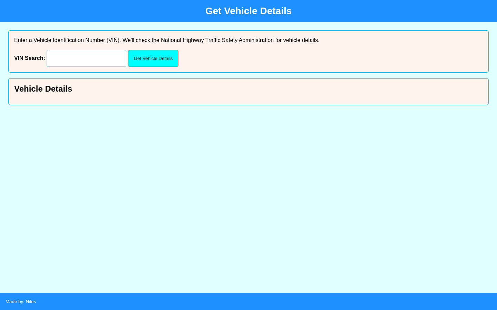
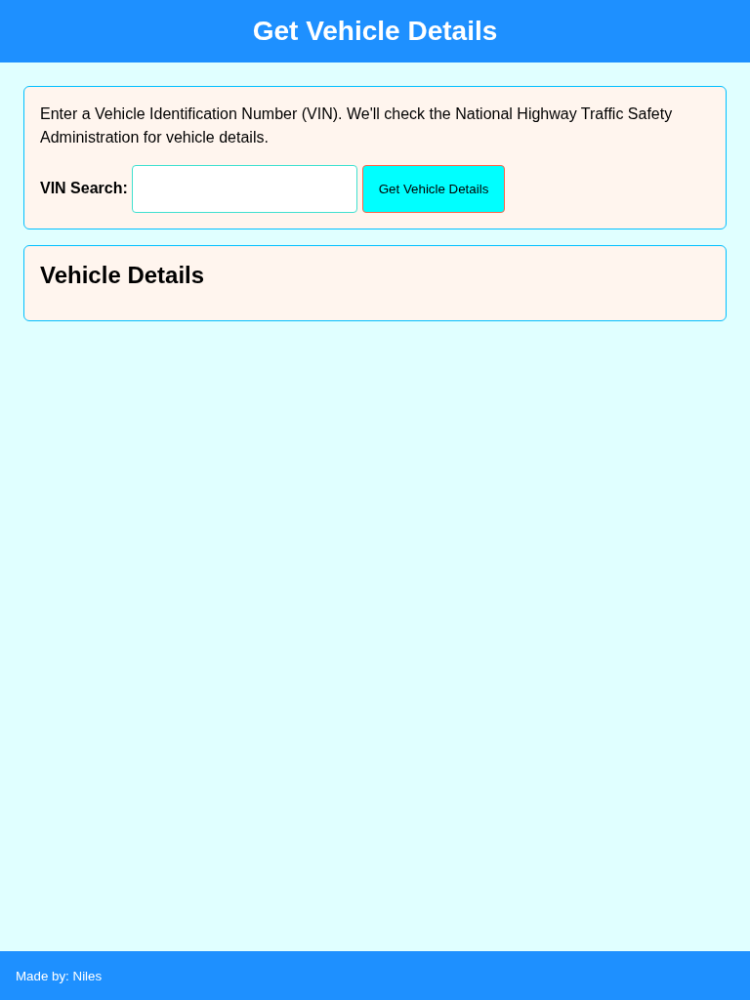
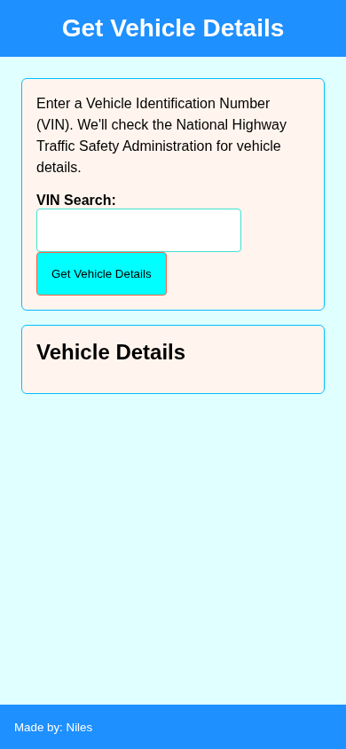

# VIN Vehicle Details Lookup

Enter a 17-character VIN to retrieve available vehicle details from NHTSA's vPIC API.

## Overview

VIN Vehicle Details Lookup lets a user enter a VIN and request decoded vehicle information from the National Highway Traffic Safety Administration Vehicle Product Information Catalog (vPIC) API.

The application processes the returned data, removes empty values, and displays the available vehicle details in the browser.

## Features

- Enter a 17-character VIN
- Validate that a VIN was entered and contains 17 characters
- Request decoded vehicle information from the NHTSA vPIC API
- Process returned vehicle data
- Ignore empty values
- Display available vehicle details dynamically

## Technologies

<p>
  <a href="https://developer.mozilla.org/en-US/docs/Web/HTML" title="HTML">
    
  </a>
  &nbsp;
  <a href="https://developer.mozilla.org/en-US/docs/Web/CSS" title="CSS">
    
  </a>
  &nbsp;
  <a href="https://developer.mozilla.org/en-US/docs/Web/JavaScript" title="JavaScript">
    
  </a>
</p>

- [NHTSA Vehicle Product Information Catalog (vPIC) API](https://vpic.nhtsa.dot.gov/api/)

## How to Run

1. Clone the repository:

```bash
git clone https://github.com/nilesleesmith/simply-get-vehical-information.git
```

2. Open the project folder.

3. Open `index.html` in a web browser.

No additional packages or build steps are required.

## Live Site

Coming soon.

## Screenshots

### Desktop



### Tablet



### Mobile


